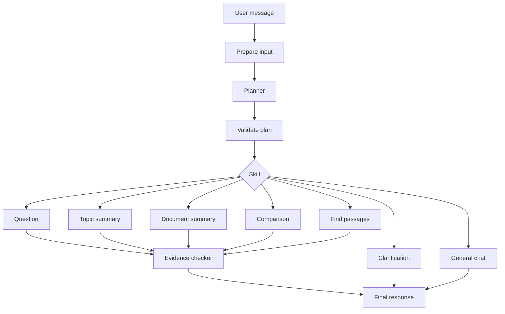

# Local research assistant

A single-user research chatbot for Swedish and English. Documents, embeddings, retrieval, and generation stay on this computer. Uses Streamlit, LangChain, Chroma, and Ollama.

## Setup (Windows PowerShell)

Install Python 3.10–3.12 and Ollama. Open PowerShell in this folder:

```powershell
python -m venv .venv
.\.venv\Scripts\python -m pip install -r requirements.txt
ollama pull llama3.2
ollama pull nomic-embed-text
.\.venv\Scripts\python -m streamlit run app.py --server.address 127.0.0.1 --server.headless true --browser.gatherUsageStats false
```

Model downloads require internet access and can be large. Once installed, Ollama must be running locally. The default chat model is `llama3.2:latest`, which is small enough to try on a typical laptop; quality and speed depend on hardware and language. `nomic-embed-text` is a starting point: evaluate Swedish, English and cross-language retrieval on representative material. To try another locally installed model, set `LOCALCHAT_CHAT_MODEL` or `LOCALCHAT_EMBED_MODEL` in PowerShell before launching. Changing the embedding model creates a separate index and requires re-indexing. Remove obsolete indexes under `storage/` when changing models, after closing the app; they can contain sensitive data.

## Use

Add PDF, DOCX, UTF-8 TXT or Markdown files to `Data/` directly, or use the upload control. The first startup indexes supported files; later starts hash files and only process changes. During indexing, the app shows the current file number, files remaining, and passage progress. Switching to the new PDF parser causes existing PDFs to be indexed once more. Use **Refresh documents** after changing the folder while the app is running. Choose documents and ask a question. Open the numbered excerpts to check the answer against the original. Edit the system prompt above the conversation to guide the assistant in either mode. Changes apply to the next answer; select **Save system prompt** to keep them across restarts, or **Restore default prompt** to load the original text. The saved prompt is shared by all chats and stored locally in `storage/system_prompt.txt`. General chat does not search documents.

The sidebar deletes files and updates the active index. Files that could not be indexed can be removed directly from `Data/`; press Refresh afterwards. Scanned PDFs need OCR before indexing. DOCX paragraphs and tables are extracted, but complex layout, comments, headers, and footnotes may be omitted. Empty or unreadable documents are reported. Files larger than 50 MB are rejected. The sidebar lets you start, reopen, and delete chats. Chats are saved locally in `storage/chats.json`, including questions, answers, and cited excerpts; deleting a chat does not delete documents.

Retrieval supplies a limited number of excerpts, so broad questions do not necessarily cover every interview. The model can make mistakes or invent citations; always verify excerpts and originals. Evaluate with representative, approved questions before using results for research.

## Privacy and storage

The app connects only to Ollama on `127.0.0.1`; use the supplied launch command to bind Streamlit to localhost. It does not upload documents to a cloud API. Model installation and updates require network access. Files in `Data/`, the index under `storage/`, model files, OS caches, and backups may contain sensitive information. Both project data directories are excluded from Git, but the researcher is responsible for device access, encryption, backups, retention, and secure disposal according to institutional rules. Standard file deletion is not guaranteed secure erasure. Do not expose the app or Ollama on a network. Only use trusted files: document parsers cannot guarantee safety against malicious inputs.

PDF text extraction uses PyMuPDF; review its AGPL/commercial licensing before distributing this application.

## LangGraph workflow

Each request runs through a compiled, reusable graph. The planner produces a Pydantic-validated decision; invalid or empty output gets one repair attempt and then deterministic fallback. The graph routes only to known skills. Document skills retrieve or process evidence, then a separate model check and citation validation decide whether to return the draft or an insufficient-evidence response. Clarification and general chat skip retrieval and checking. Model checks are fallible and do not guarantee correctness or protection from prompt injection. Check original documents before relying on an answer.



The graph state holds the request, recent scoped conversation, selected filenames, plan, retrieved chunks, draft and check result. Conditional edges route the validated skill. Each invocation starts a fresh state; the existing `storage/chats.json` is authoritative for messages, metadata and source excerpts, while `storage/system_prompt.txt` holds the shared prompt. Graph state is not checkpointed or persisted. Old history remains readable; new answers include skill and planner metadata. The vector index and manifest remain under `storage/` and do not require migration.

The automatic planner selects **answer question** for focused questions, **summarize topic** for broader coverage, **summarize selected documents** to process all indexed chunks in order, **compare information** for separate searches, **find information** for direct passages, **clarify question** when a request needs detail, and **general chat** for conversation without retrieval. The advanced controls let you select a task and a summary detail level. Whole-document summaries map ordered groups of passages to section summaries before combining them; topic summaries use search and cannot promise full coverage. The index only contains extracted text; scanned PDFs need OCR and complex DOCX layout can be lost. Numbered source cards show original excerpts, but their presence alone does not prove a claim.

Set environment variables shown in `.env.example` before starting the app; the file is an example and is not loaded automatically. Set `LOCALCHAT_DEBUG=true` or use Advanced options to see routing and check details. Other available settings are `LOCALCHAT_TOPIC_QUERIES`, `LOCALCHAT_MAX_PER_DOCUMENT`, `LOCALCHAT_CONFIDENCE_THRESHOLD`, `LOCALCHAT_CHUNK_SIZE`, and `LOCALCHAT_CHUNK_OVERLAP`. Changing chunk settings requires a fresh index; retain backups before rebuilding. Keep the Ollama URL on localhost to preserve local-only operation.

Run deterministic tests and the offline routing baseline with:

```powershell
.\.venv\Scripts\python -m pytest -q
.\.venv\Scripts\python evaluate.py
```

The evaluation records illustrate desired routing and risk cases; the runner currently measures routing and clarification only. It does not execute models, check sources, or measure fact coverage, unsupported claims, citation validity, or insufficient-evidence accuracy. Simple string matching would not establish semantic correctness. Validate those separately against representative documents and review results manually.

For manual checks, select indexed documents and try: a deadline question, an international-student topic summary, a detailed summary of the selected document, a comparison of two named programs, and a request to locate a language requirement. Try “Compare the requirements” to check clarification, ask about an absent fact to check insufficient evidence, and switch to General chat to rewrite a sentence without retrieval. Simulate invalid and null planner output with the automated tests. Confirm the numbered source excerpts against the files.

To add a skill, add its identifier to the validated `Skill` type and registry in `agent.py`, implement its bounded retrieval and generation in `Skills.run`, and add routing and evidence tests. The application does not allow a model to create tools or skills.

If Ollama is unavailable, start it and verify both models with `ollama list`; pull missing models as shown above. Refresh documents after changing `Data/`. If retrieval is incomplete, select the intended indexed documents and inspect extraction; search can miss relevant passages. Large documents may exceed a model's effective context, and model-based evidence checking can reject good answers or miss unsupported claims. The app does not stream responses; failed requests are not saved as completed messages.
