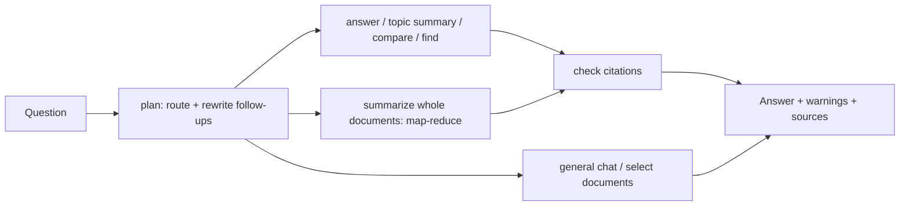

# Local research assistant

A single-user research chatbot for Swedish and English. Documents, embeddings, retrieval, and generation stay on this computer. Uses Streamlit, LangChain, Chroma, and Ollama.

## Setup (Windows PowerShell)

Install Python 3.10–3.12 and Ollama. Open PowerShell in this folder:

```powershell
python -m venv .venv
.\.venv\Scripts\python -m pip install -r requirements.txt
ollama pull llama3.2
ollama pull nomic-embed-text
.\.venv\Scripts\python -m streamlit run app.py --server.address 127.0.0.1 --server.headless true --browser.gatherUsageStats false
```

Model downloads require internet access and can be large. Once installed, Ollama must be running locally. The default chat model is `llama3.2:latest`, which is small enough to try on a typical laptop; quality and speed depend on hardware and language. `nomic-embed-text` is a starting point: evaluate Swedish, English and cross-language retrieval on representative material. To try another locally installed model, set `LOCALCHAT_CHAT_MODEL` or `LOCALCHAT_EMBED_MODEL` in PowerShell before launching. Changing the embedding model creates a separate index and requires re-indexing. Remove obsolete indexes under `storage/` when changing models, after closing the app; they can contain sensitive data.

## Use

Add PDF, DOCX, UTF-8 TXT or Markdown files to `Data/` directly, or use the upload control. The first startup indexes supported files; later starts hash files and only process changes. During indexing, the app shows the current file number, files remaining, and passage progress. Switching to the new PDF parser causes existing PDFs to be indexed once more. Use **Refresh documents** after changing the folder while the app is running. Choose documents and ask a question. Open the numbered excerpts to check the answer against the original. Edit the system prompt (expander above the conversation) to guide the assistant in either mode. Changes apply to the next answer; select **Save system prompt** to keep them across restarts, or **Restore default prompt** to load the original text. The saved prompt is shared by all chats and stored locally in `storage/system_prompt.txt`. General chat does not search documents.

The sidebar deletes files and updates the active index. Files that could not be indexed can be removed directly from `Data/`; press Refresh afterwards. Scanned PDFs need OCR before indexing. DOCX paragraphs and tables are extracted, but complex layout, comments, headers, and footnotes may be omitted. Empty or unreadable documents are reported. Files larger than 50 MB are rejected. The sidebar lets you start, reopen, and delete chats. Chats are saved locally in `storage/chats.json`, including questions, answers, and cited excerpts; deleting a chat does not delete documents.

Retrieval supplies a limited number of excerpts, so broad questions do not necessarily cover every interview. The model can make mistakes or invent citations; always verify excerpts and originals. Evaluate with representative, approved questions before using results for research.

## Privacy and storage

The app connects only to Ollama on `127.0.0.1`; use the supplied launch command to bind Streamlit to localhost. It does not upload documents to a cloud API. Model installation and updates require network access. Files in `Data/`, the index under `storage/`, model files, OS caches, and backups may contain sensitive information. Both project data directories are excluded from Git, but the researcher is responsible for device access, encryption, backups, retention, and secure disposal according to institutional rules. Standard file deletion is not guaranteed secure erasure. Do not expose the app or Ollama on a network. Only use trusted files: document parsers cannot guarantee safety against malicious inputs.

PDF text extraction uses PyMuPDF; review its AGPL/commercial licensing before distributing this application.

## How it works

Each request runs through a small LangGraph workflow in `agent.py`:



- **Routing** is rule-based (English and Swedish keywords) and instant; choose a task under **Options** to override it. Without selected documents the app asks you to select some.
- **Follow-up questions** are rewritten by the model into a standalone search query using the recent conversation.
- **Answers** stream as they are written and must cite numbered excerpts. Missing or invalid citations are shown as warnings; only cited excerpts are shown below the answer.
- **Double-check** (Options, or `LOCALCHAT_VERIFY=true`) asks the model to compare the answer with the cited excerpts and adds a warning for unsupported statements. It is slower and also fallible.
- **Summarize selected documents** reads every passage in parts (progress is shown) and combines the notes. Very large selections (more than `LOCALCHAT_MAX_SUMMARY_PARTS` parts) fall back to a summary of the most relevant passages, with a warning.

Small local models make mistakes, including wrong facts with plausible citations. Always open the cited excerpts. A larger model (e.g. `LOCALCHAT_CHAT_MODEL=llama3.1:8b`) gives better answers but is much slower on a laptop without a GPU.

## Settings

Set environment variables from `.env.example` before starting the app (the file is not loaded automatically). `LOCALCHAT_NUM_CTX` is the model context window; `LOCALCHAT_MAX_CONTEXT` is the maximum characters of source text per model call and must fit inside it. Changing `LOCALCHAT_CHUNK_SIZE`, `LOCALCHAT_CHUNK_OVERLAP` or the embedding model requires re-indexing. Keep the Ollama URL on localhost.

## Tests

```powershell
.\.venv\Scripts\python -m pytest -q
.\.venv\Scripts\python evaluate.py
```

Tests use fake models and need no Ollama. `evaluate.py` checks routing only, not answer quality; evaluate answers manually against representative documents.

If Ollama is unavailable, start it and check the models with `ollama list`. Press **Refresh documents** after changing `Data/` while the app is running.
